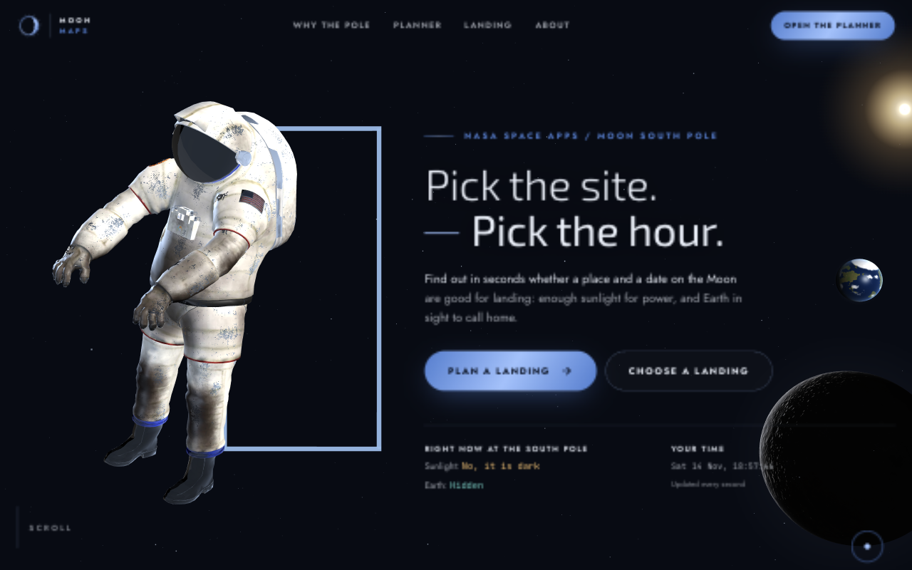
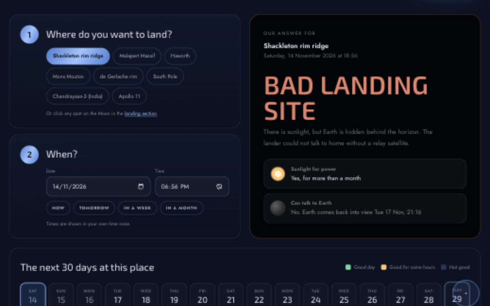

# Validation report

Status: Evidence for the build merged in pull request 3. Last updated: 2026-11-14.

This file records what we checked to show that Moon Maps works and that its numbers are right. Every result below was produced by running the code on 2026-11-14 and is shown with the command or source behind it. It also lists what we have **not** yet checked. The method behind the science checks is in [science/validation.md](science/validation.md).

## Summary

| Area | Result | Evidence |
| --- | --- | --- |
| Continuous integration | All jobs pass | [CI run on the pull request](https://github.com/itani-jr-404/moonmaps/actions/runs/43618617734) and [CI run on `main` after the merge](https://github.com/itani-jr-404/moonmaps/actions/runs/43618742905) |
| API tests | 36 of 36 pass | [Section 1](#1-automated-tests) |
| Web tests, lint, types, build | 32 of 32 tests pass; lint, type check and production build pass | [Section 1](#1-automated-tests) |
| Sun and Earth positions against NASA JPL Horizons | 16 of 16 cases within 0.05 degrees; largest difference 0.0123 degrees | [Section 2](#2-positions-against-nasa-jpl-horizons) |
| Physical sanity checks against NASA's Moon fact sheet | Earth to Moon distance stays inside NASA's stated range | [Section 3](#3-physical-sanity-checks) |
| Terrain from NASA LOLA | File layout matches its label; Shackleton crater appears as a bowl; a known permanently shadowed impact point gets 0 % sunlight | [Section 4](#4-terrain-and-horizon) |
| API behaviour | Every endpoint answers; every documented error code is returned; answers take 10 to 41 ms | [Section 5](#5-api-behaviour) |
| Web app in a browser | Hero, globe, landing and planner show the API's answers; the screen and the API agree to the minute | [Section 6](#6-web-app-in-a-browser) |
| Sources | Every number and dataset has a source or is marked "to confirm" | [Section 8](#8-sources-and-citations) |
| Not yet checked | Listed honestly | [Section 9](#9-what-is-not-validated-yet) |

## 1. Automated tests

Commands, run from the repository root on 2026-11-14:

```bash
cd apps/api && uv run pytest -v          # 36 passed
pnpm test                                 # 32 passed (5 files)
pnpm lint && pnpm typecheck               # no errors
pnpm build                                # production build succeeds
pnpm contracts:check                      # API models, openapi.json and api.d.ts agree
python3 scripts/check_docs_links.py       # 0 broken links
```

### API tests (pytest), 36 passed

| File | What it proves |
| --- | --- |
| `tests/test_geometry.py` (7) | The great-circle walk and the elevation-angle formula give the hand-worked answers, including the drop of a distant point below the horizontal because the Moon is round |
| `tests/test_projection.py` (3) | Latitude and longitude map to the right pixel of a polar grid: the pole is at the centre, longitude 0 points up and 90 E points right, as the LOLA catalogue file says |
| `tests/test_horizon.py` (4) | A flat grid gives a level horizon; a mountain placed due east raises the horizon at azimuth 90 by the expected angle; the profile wraps at 360 degrees; the finest grid is used first |
| `tests/test_visibility.py` (7) | Visibility, window edges between samples, windows open at either end, overlaps, every metric, and the go, caution and no-go thresholds |
| `tests/test_horizons.py` (1) | All 16 saved JPL Horizons cases agree within 0.05 degrees |
| `tests/test_lola_grid.py` (2) | The real LOLA file has the size, scale and centre its label states, and Shackleton crater is a deep bowl on the correct side |
| `tests/test_api.py` (12) | Each endpoint returns its model; unknown site, too many samples, dates outside the kernels, bad input and too many scenarios each return the documented error |

### Web tests (Vitest), 32 passed

| File | What it proves |
| --- | --- |
| `src/lib/format/format.test.ts` (3) | Durations, coordinates, signed angles and compass words read correctly |
| `src/features/planner/lib/calendar.test.ts` (11) | The 30-day calendar adds up the good hours of each local day, grades days, ranks the best windows and jumps to a good moment. These 11 tests also pass with the computer set to UTC, New York, Kolkata, Chatham and Beirut time (`TZ=... pnpm exec vitest run src/features/planner`) |
| `src/lib/state/url-sync.test.ts` (3) | A place and a time survive a round trip through the address; bad addresses fall back safely |
| `src/features/landing/lib/verdict.test.ts` (5) | "Good landing site" only when both the Sun and the Earth are visible; the right explanation for each case; the nearest curated site within 2.2 degrees |
| `src/scene/units.test.ts` (10) | Converting between latitude and longitude, compass directions and 3D directions is consistent |

## 2. Positions against NASA JPL Horizons

JPL Horizons is NASA's reference service for the positions of Solar System bodies, and it can place an observer on the Moon (https://ssd.jpl.nasa.gov/horizons/). We fetched 16 reference values with `apps/api/scripts/fetch_horizons.py` on 2026-11-14 at 16:15 UTC, through the Horizons API (https://ssd.jpl.nasa.gov/api/horizons.api, quantity 4: airless apparent azimuth and elevation, observer `coord@301`). The values are saved in `apps/api/app/data/validation/horizons.json`. Our values come from Skyfield with NASA JPL's DE421 kernels, with the observer on the 1737.4 km sphere that Horizons uses. The table is the output of `GET /validation`.

Tolerance: 0.05 degrees in azimuth and elevation. Largest difference: **0.0123 degrees**. All 16 cases pass.

| Point | Time (UTC) | Body | Horizons az / el | Ours az / el | Difference az / el | Pass |
| --- | --- | --- | --- | --- | --- | --- |
| 89.9 S, 0 E | 2026-11-15 00:00 | Sun | 114.4337 / 1.5150 | 114.4376 / 1.5150 | 0.0038 / 0.0000 | yes |
| 89.9 S, 0 E | 2026-11-22 00:00 | Sun | 29.3109 / 1.6235 | 29.3146 / 1.6235 | 0.0038 / 0.0000 | yes |
| 89.9 S, 0 E | 2026-11-29 00:00 | Sun | 304.3655 / 1.5402 | 304.3692 / 1.5402 | 0.0038 / 0.0000 | yes |
| 89.9 S, 0 E | 2026-12-06 00:00 | Sun | 219.1905 / 1.3736 | 219.1943 / 1.3736 | 0.0038 / 0.0000 | yes |
| 89.9 S, 0 E | 2026-11-15 00:00 | Earth | 357.3802 / -3.4530 | 357.3806 / -3.4534 | 0.0004 / 0.0004 | yes |
| 89.9 S, 0 E | 2026-11-22 00:00 | Earth | 353.6205 / 5.4363 | 353.6202 / 5.4361 | 0.0003 / 0.0002 | yes |
| 89.9 S, 0 E | 2026-11-29 00:00 | Earth | 5.1372 / 1.6731 | 5.1368 / 1.6736 | 0.0004 / 0.0005 | yes |
| 89.9 S, 0 E | 2026-12-06 00:00 | Earth | 5.2515 / -6.5627 | 5.2517 / -6.5626 | 0.0002 / 0.0001 | yes |
| 0.67416 N, 23.47314 E | 2026-11-15 00:00 | Sun | 91.5459 / -0.9767 | 91.5458 / -0.9805 | 0.0001 / 0.0038 | yes |
| 0.67416 N, 23.47314 E | 2026-11-22 00:00 | Sun | 110.7545 / 83.7592 | 110.7423 / 83.7557 | 0.0123 / 0.0035 | yes |
| 0.67416 N, 23.47314 E | 2026-11-29 00:00 | Sun | 268.3588 / 10.8716 | 268.3587 / 10.8754 | 0.0001 / 0.0038 | yes |
| 0.67416 N, 23.47314 E | 2026-12-06 00:00 | Sun | 267.0385 / -74.2649 | 267.0392 / -74.2611 | 0.0006 / 0.0038 | yes |
| 0.67416 N, 23.47314 E | 2026-11-15 00:00 | Earth | 276.1275 / 63.6835 | 276.1284 / 63.6839 | 0.0009 / 0.0004 | yes |
| 0.67416 N, 23.47314 E | 2026-11-22 00:00 | Earth | 257.7238 / 59.4017 | 257.7244 / 59.4014 | 0.0006 / 0.0002 | yes |
| 0.67416 N, 23.47314 E | 2026-11-29 00:00 | Earth | 262.1501 / 71.4074 | 262.1487 / 71.4070 | 0.0014 / 0.0004 | yes |
| 0.67416 N, 23.47314 E | 2026-12-06 00:00 | Earth | 287.9388 / 70.8555 | 287.9387 / 70.8558 | 0.0001 / 0.0003 | yes |

The largest difference (0.0123 degrees, in azimuth) is for the Sun 83.8 degrees high, where a small shift in position moves the azimuth a lot. Most Sun cases differ by about 0.0038 degrees in one coordinate. This looks like a small constant offset; it is ten times smaller than the tolerance, and its cause has not been investigated. Our ephemeris (DE421) is older than the one Horizons uses; [science/conventions-and-ephemeris.md](science/conventions-and-ephemeris.md) gives the reasons this is acceptable.

The point 0.67416 N, 23.47314 E is the Apollo 11 site position from LROC (https://lroc.im-ldi.com/images/938), used here only as a low-latitude test point.

## 3. Physical sanity checks

These compare long runs of our engine with independent published values. The reference is NASA's Moon Fact Sheet (https://nssdc.gsfc.nasa.gov/planetary/factsheet/moonfact.html, author Dr. David R. Williams, NSSDCA, NASA Goddard Space Flight Center, last updated 11 January 2024, read 2026-11-14).

| Check | Our result | Reference | Agrees |
| --- | --- | --- | --- |
| Distance from the Moon to the Earth over all of 2027 (every 3 hours, `GET /scene` engine) | 357,284 km to 406,607 km | The fact sheet: the distance "roughly ranges from 357,000 km to 407,000 km" | Yes |
| Moon radius used for the observer and the terrain | 1737.4 km | The fact sheet's volumetric mean radius is 1737.4 km; the LOLA label's reference radius is 1737.4 km | Yes |

Two more checks show the behaviour the challenge describes. Their expected values do not yet have a cited source, so they are results, not proofs:

| Check | Our result | Note |
| --- | --- | --- |
| Highest and lowest Sun elevation at 89.9 S, 0 E over 2027, on a smooth Moon | +1.63 to -1.63 degrees | The Sun stays within a couple of degrees of the horizon all year near the pole. The expected limit, set by the tilt of the Moon's axis, is to confirm with a source. |
| Earth elevation at 89.9 S, 0 E over 2027 | +6.67 to -7.00 degrees | The Earth rises and sets near the pole. The expected range, set by libration, is to confirm with a source. |
| Earth position seen from the Apollo 11 point over January 2027 | Azimuth 255.5 to 290.5 degrees, elevation 58.0 to 73.2 degrees | From the near side the Earth stays in one region of the sky and only wobbles, as described in [science/validation.md](science/validation.md). |

## 4. Terrain and horizon

The horizon comes from NASA's Lunar Orbiter Laser Altimeter (LOLA) on the Lunar Reconnaissance Orbiter.

**File layout.** The label `LDEM_80S_80M.LBL` (https://imbrium.mit.edu/DATA/LOLA_GDR/POLAR/IMG/LDEM_80S_80M.LBL, read 2026-11-14) gives 7600 by 7600 pixels, 16-bit little-endian integers, 0.5 m per unit, 80 m per pixel, pole at pixel 3799.5, frame "MEAN EARTH/POLAR AXIS OF DE421". `tests/test_lola_grid.py` checks the reader against these values. The projection follows the LOLA catalogue file DSMAP_POLAR.CAT (https://imbrium.mit.edu/CATALOG/DSMAP_POLAR.CAT).

**Orientation.** Shackleton crater is near 89.67 S, 129.78 E. Our reader finds a floor about 2.8 km below the reference sphere there, and about 0.7 km above it at the mirrored longitude. This shows the map is not flipped. The source of the Shackleton position used in the test is still to confirm.

**A permanently shadowed point gets no sunlight.** The LCROSS mission "impacted a spent Centaur rocket stage into a permanently shadowed region near the lunar south pole" (Marshall et al., "Locating the LCROSS Impact Craters", arXiv:1103.1687, https://arxiv.org/abs/1103.1687). At the impact point they give (84.6796 S, 48.7093 W):

| Check | Our result |
| --- | --- |
| Share of 2027 with the Sun visible, with LOLA terrain | **0.0 %** |
| Highest Sun elevation in 2027 above the level horizon, ignoring terrain | 6.83 degrees |
| Sun at the impact time, 2009-10-09 11:31:19 UTC | 6.52 degrees high but 4.65 degrees below the terrain horizon at its azimuth |

The Sun does rise above the level horizon at that point, so the darkness comes from the terrain step, not from the geometry. This is the result the paper's description predicts.

**Synthetic terrain.** `tests/test_horizon.py` places a 2 km high mountain whose edge is 10 km east of a site. The horizon at azimuth 90 comes out within 0.2 degrees of the exact angle, and the other directions stay below the level horizon.

**Speed.** A new horizon profile takes 17 to 35 ms (575 samples in each of 360 directions).

## 5. API behaviour

Measured on the development laptop on 2026-11-14 against the running API (`uv run uvicorn app.main:app`). These are single requests, not a load test.

| Request | Answer |
| --- | --- |
| `GET /health` | `{"ok":true,"kernels":true,"dem":["lola-80s-80m","lola-75s-120m"],"version":"0.1.0"}` |
| `GET /sites` | 17 sites, each with a source link ([data/sites.md](data/sites.md), `research/site-coordinates.md`) |
| `GET /sky?lat=-89.684&lon=-163.261&t=2026-11-14T14:56:00Z` (Shackleton ridge) | Sun at azimuth 282.29, elevation 1.62, 3.02 degrees above the terrain: visible. Earth at elevation -4.29, 4.30 degrees below the terrain: hidden. Horizon from `lola-80s-80m`. |
| `GET /scene?t=2026-11-14T14:56:00Z` | Sub-solar point 1.56 S, 119.04 E; sub-Earth point 3.74 N, 2.09 W; Earth 405,200 km away |
| `POST /analyze` with an unknown site id | 404 `unknown_site` |
| `POST /analyze` with one year at 5-minute steps | 422 `range_too_long` |
| `POST /analyze` in 2060 | 422 `out_of_ephemeris_range` |
| `POST /analyze` with latitude -95 | 422 `invalid_input`, naming the field |
| `GET /sky` for three new points (horizon built from terrain) | 41 ms, 20 ms, 22 ms |
| `POST /analyze`, 4 sites, 30 days at 30-minute steps, no series | 36 ms, 14 kB |

## 6. Web app in a browser

The production build (`pnpm build`, then `next start`) was opened against the running API on 2026-11-14. The API's request log showed each request the page made, with status 200 and no errors.

| What was checked | Result |
| --- | --- |
| Hero: "Right now at the south pole" | Shows "Sunlight: No, it is dark" and "Earth: Hidden" from `GET /sky` for 89.9 S, 0 E. The clock ticks every second. |
| Choose a landing: aiming at the globe | The card showed "Bad landing site, Spot 82.6°S, 91.2°W, Sunlight right now: No, Can see Earth: No" with the matching explanation. The API log shows the `GET /sky` call for that point. |
| Choose a landing: clicking to land | The surface view asked `GET /sky` for the exact moment at the landed point (-82.5629, -91.1805). |
| Planner, opened from the address `?site=shackleton-ridge&t=2026-11-14T14:56Z` | Shows "Shackleton rim ridge, Saturday 14 November 2026 at 16:56" (Beirut time, UTC+2), "Bad landing site", "Sunlight for power: Yes, for more than a month", "Can talk to Earth: No. Earth comes back into view Tue 17 Nov, 21:16". |
| Planner agrees with the API | `POST /analyze` for the same site and moment gives `next_earthrise` 2026-11-17 19:16:03 UTC, which is 21:16 in Beirut. Sun visible and Earth hidden at the start match the card. |
| Best times | "Tue 17 Nov, 21:16 until Mon 30 Nov, 12:47, 12 days 16 hours". It matches the API's first window in which both are visible, 2026-11-17 19:16 to 2026-11-30 10:47 UTC. |
| 3D site view | Shows "Horizon from NASA LOLA terrain (80 m grid)", as returned by `GET /sky` (`horizon_source: lola-80s-80m`). |

Screenshots taken during this check:





Limits of this check: the browser used for testing slowed animation to about 1.5 frames per second, so the intro timing and the smoothness of the 3D scenes were not judged. Phones and the reduced-motion mode were not tried in a browser; the reduced-motion paths are in the code but not seen working.

## 7. Year-long results and an open finding

`POST /analyze` for all of 2027 at 1-hour steps, with LOLA terrain:

| Site | Sunlight | Earth visible | Both | Longest dark spell | Power / communication |
| --- | --- | --- | --- | --- | --- |
| `shackleton-ridge` | 79.0 % | 45.6 % | 39.6 % | 206 h | no-go / caution |
| `malapert-massif` | 38.4 % | 35.5 % | 10.8 % | 637 h | no-go / caution |
| `de-gerlache-rim-2` | 17.0 % | 49.9 % | 12.1 % | 3346 h | no-go / caution |
| `apollo-11` (smooth Moon) | 48.6 % | 100 % | 48.6 % | 355 h | no-go / go |

**Open finding.** The `de-gerlache-rim-2` point comes from a study that selected it as a favourable landing point (Peña-Asensio et al., arXiv:2406.19863, see `research/site-coordinates.md`), yet we find only 17 % sunlight. The cause we can see is local slope. The ground 160 m north of the point is about 54 m higher, so a 2 m observer there has a horizon of about 21 degrees toward the north-north-west, 240 m away. Malapert's point also has its highest horizon only 160 m away (8.3 degrees). Possible reasons: the representative point is on a slope rather than a summit, the study used another grid or observer height, or we have an error. Until we compare our sunlight shares with NASA Goddard's PGDA illumination maps (Mazarico et al., 2011, https://pgda.gsfc.nasa.gov/products/69), **the per-site percentages are not validated.** The positions of the Sun and the Earth (Section 2) and the terrain reader (Section 4) are validated.

## 8. Sources and citations

Every source used by the code and the data, and where it is cited:

| Source | Owner | Used for | Cited in |
| --- | --- | --- | --- |
| JPL kernels `de421.bsp`, `moon_pa_de421_1900-2050.bpc`, `moon_080317.tf`, `pck00008.tpc` (https://naif.jpl.nasa.gov/pub/naif/generic_kernels/) | NASA JPL, NAIF | Sun and Earth positions, the Moon's orientation | `apps/api/app/engines/ephemeris.py`, `scripts/download_data.py`, [data/sources.md](data/sources.md) |
| JPL Horizons API (https://ssd.jpl.nasa.gov/api/horizons.api) | NASA JPL | Reference values for testing | `scripts/fetch_horizons.py`, `app/data/validation/horizons.json`, [science/validation.md](science/validation.md) |
| LOLA grids `LDEM_80S_80M`, `LDEM_75S_120M` and labels (https://imbrium.mit.edu/DATA/LOLA_GDR/POLAR/IMG/) | NASA LRO LOLA team, Goddard | Terrain horizon | `app/engines/terrain.py`, [science/terrain-and-horizon.md](science/terrain-and-horizon.md) |
| LOLA projection description DSMAP_POLAR.CAT (https://imbrium.mit.edu/CATALOG/DSMAP_POLAR.CAT) | NASA LRO LOLA team | Latitude and longitude to pixel | `app/engines/terrain.py` |
| Skyfield (https://rhodesmill.org/skyfield/) | Brandon Rhodes | Reading the kernels; observer on the Moon | `app/engines/ephemeris.py`, [reference/references.md](reference/references.md) |
| Site coordinates: LROC, USGS, IAU gazetteer and published papers | Listed per site | The 17 curated sites | `app/data/sites.json` (`source_url`), `research/site-coordinates.md` |
| CGI Moon Kit (https://svs.gsfc.nasa.gov/4720) | NASA Scientific Visualization Studio | Moon colour and relief images | `apps/web/src/scene/textures.ts`, `research/web-assets.md`, the site footer |
| NASA 3D Resources (https://science.nasa.gov/3d-resources/) | NASA | Astronaut and lunar module models | `apps/web/src/scene/models.ts`, `research/web-assets.md`, the site footer |
| Moon Fact Sheet (https://nssdc.gsfc.nasa.gov/planetary/factsheet/moonfact.html) | NASA NSSDCA, Goddard | Distance range and radius checks in this report | This file, [reference/references.md](reference/references.md) |
| Marshall et al., arXiv:1103.1687 | The authors | LCROSS impact point and its permanent shadow | `research/site-coordinates.md`, this file |
| Every library, with version and licence | Their authors | Building and running the app | [reference/references.md](reference/references.md) |
| AI assistance | Anthropic (Claude) | Writing code, tests and documents, reviewed by the team | [reference/ai-use.md](reference/ai-use.md) |

Items still marked "to confirm" are listed in [CURRENT_STATE.md](CURRENT_STATE.md#to-confirm-before-relying-on-it). They include the Quickmap check of the site coordinates, the source of the Shackleton test position, the crater shapes of the decorative 3D ground, and the credit lines for the 3D models.

## 9. What is not validated yet

- Per-site sunlight and Earth-visibility percentages against NASA's PGDA illumination maps (Section 7).
- The site coordinates have not been opened in Quickmap or Moon Trek to check by eye.
- The app on phones, in reduced-motion mode, and at full animation speed.
- Performance under many users. The timings in Section 5 are single requests on a laptop.
- The deployed app. Nothing is deployed yet.
- Past landings. Two first checks are done: the LCROSS point in Section 4, and SLIM below. Judges' point 1 asks for more.

**SLIM, first check.** At SLIM's landing time from LROC, 19 January 2024 at 15:20 UTC, at 13.316 S, 25.251 E (https://lroc.im-ldi.com/images/1358), our API gives the Sun 37.2 degrees above the horizon and the Earth 68.2 degrees above it. We have not yet compared this with a mission source.

## 10. Judges' feedback and what we will do

We received the judges' feedback and will act on it. Their main points, with our plan:

1. **Check our results against past missions to narrow the error range.** Take the dates and sites of past landings and impacts, compute what our app says for them, and compare with what the missions reported. First steps are in Sections 4 and 9 (LCROSS and SLIM). Next: the Apollo landings and Chandrayaan-3, each with a mission source for its landing time and lighting.
2. **Show the distance from the Earth to the Moon.** The API already computes it (`earth_distance_km` in `GET /scene`), and it is checked against NASA's range in Section 3. Next: show it in the app for the chosen date.
3. **Show how long the trip to the Moon takes.** The feedback's example said Mars takes 3 to 4 days. It most likely meant the Moon. Next: show typical travel times for past missions, each taken from a mission source. We will not show a number until it has a source.
4. **Forecast where the Earth will be, like a weather forecast.** The positions of the Earth and the Moon change over time. So for each landing site, show a forecast of where the Earth (and the Sun) will be in its sky over the coming days, with when each will rise and set. The planner's 30-day calendar already forecasts the good landing windows. Next: add the forecast of the Earth's and the Sun's paths in the sky above each site's terrain horizon.

These are recorded as planned features in [features/README.md](features/README.md).
