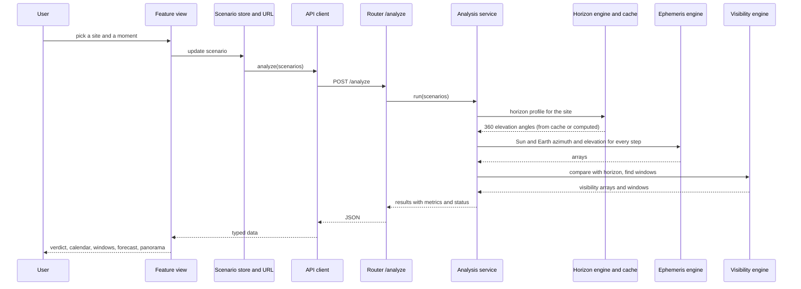
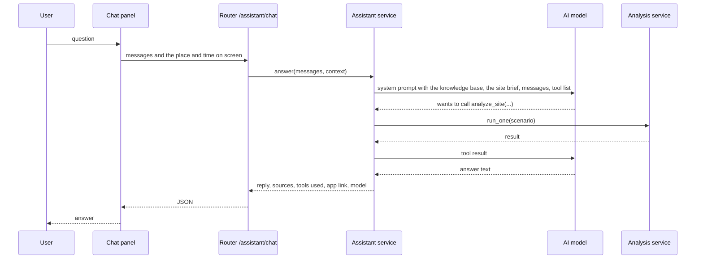

# Request lifecycle

Status: Built. Last updated: 2026-11-15.

Three flows cover what the app does: analysing a scenario, one moment at one point, and asking the assistant.

## 1. Analysing a scenario

This is the core path. The planner's verdict, calendar and best windows come from it, and so do the outlook, sky forecast and horizon panorama on each site's page.

Notes:

- The planner sends one `POST /analyze` with two scenarios: the chosen moment for the verdict, and the 30 days from local midnight today for the calendar and the best windows. A site's page sends one `POST /analyze` for the next 30 days with the series; its outlook, sky forecast, panorama and "Getting there" share that one answer.
- Changing the site or the moment calls the API. Results are cached in the browser by scenario (TanStack Query) and in the API (200 results), so going back to an earlier scenario is fast.
- The horizon profile is cached in memory and on the API's disk by point, rounded to 0.001 degrees. The first request for a new point pays the cost (tens of milliseconds for a south polar point); later ones do not.

## 2. One moment at one point

| Scene | Calls | When |
| --- | --- | --- |
| Hero readout | `GET /sky` at 89.9 S, 0 E | On load, then once a minute |
| Globe | `GET /sites`; `GET /sky` at the aimed point, rounded to 0.1 degree and 10 minutes | While aiming |
| Landed view | `GET /sky` at the chosen point and moment; `POST /analyze` for the terrain horizon drawn as the skyline, and for the next sunrise when "Skip to sunrise" is pressed | When the point or moment changes |
| Planner diorama | `GET /sky` at the chosen point and moment | When the point or moment changes |
| Sites index | `GET /sites`; `GET /sky` for each site now | On load |
| A site's page | `GET /sky` and `GET /scene` now ("Right now"); `GET /terrain` for the elevation map; `GET /missions` and `GET /missions/departures` for "Getting there" | On load |

The scenes place the Sun and the Earth from the `/sky` answer and use its `visible` flags. They compute no positions ([ADR-011](../decisions/ADR-011-sky-endpoint.md)). The landed view draws the API's terrain horizon as its far skyline ([ADR-016](../decisions/ADR-016-landed-view-real-skyline.md)). `GET /terrain` feeds the 2D elevation map; a 3D site view built from it is planned. See [frontend/3d-scenes.md](../frontend/3d-scenes.md).

## 3. Asking the assistant

The context is the curated site or the point on screen and the planner's moment. When a place is on screen, the service first runs the analysis for 30 days from the chosen moment, or from now, and gives it to the model as the site brief. The model's tools are `list_sites`, `analyze_site`, `sky_at`, `moon_scene`, `accuracy_report` and `past_missions`; each calls an API service. The service allows at most three rounds of tool calls in one answer (`MAX_TOOL_ROUNDS` in `apps/api/app/services/assistant.py`). See [backend/assistant.md](../backend/assistant.md).

## When something fails

| Failure | What the user sees |
| --- | --- |
| Invalid input | The API answers `invalid_input` with the field's name; values from the URL are checked before use |
| API returns an error | The panel shows the message from the error and a retry button; other panels keep their last good data |
| API cannot be reached | Each section shows its error state. Precomputed fallback results are planned, not built |
| 3D cannot start (no WebGL) | The home page works without its 3D stage; on "choose a landing" the globe area says the browser cannot show the 3D Moon. The planner's numbers and the site pages do not depend on 3D |
| Assistant fails | The chat panel shows "Signal lost" and retries, then offers a Retry button, or shows the API's own message; nothing else is affected |
