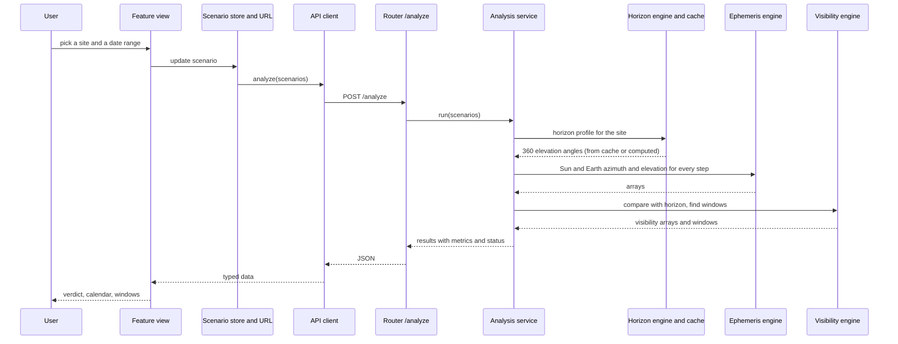

# Request lifecycle

Status: Partly built. Last updated: 2026-11-14.

Two flows cover what the app does today; the third, the assistant, is planned.

## 1. Analysing a scenario

This is the core path. The planner's verdict, calendar and best windows come from it.

Notes:

- Changing the site or the moment calls the API. Results are cached in the browser by scenario (TanStack Query) and in the API (200 results), so going back to an earlier scenario is fast.
- The horizon profile is cached in memory and on the API's disk by point, rounded to 0.001 degrees. The first request for a new point pays the cost (tens of milliseconds for a south polar point); later ones do not.

## 2. One moment at one point

| Scene | Calls | When |
| --- | --- | --- |
| Hero readout | `GET /sky` at 89.9 S, 0 E | On load, then once a minute |
| Globe | `GET /sites`; `GET /sky` at the aimed point, rounded to 0.1 degree and 10 minutes | While aiming |
| Surface view and planner diorama | `GET /sky` at the chosen point and moment | When the point or moment changes |

The scenes place the Sun and the Earth from the `/sky` answer and use its `visible` flags. They compute no positions ([ADR-011](../decisions/ADR-011-sky-endpoint.md)). A terrain tile from `GET /terrain` for a real 3D site view is planned. See [frontend/3d-scenes.md](../frontend/3d-scenes.md).

## 3. Asking the assistant (planned)

The assistant service limits the number of tool calls in one answer. See [backend/assistant.md](../backend/assistant.md).

## When something fails

| Failure | What the user sees |
| --- | --- |
| Invalid input | The API answers `invalid_input` with the field's name; values from the URL are checked before use |
| API returns an error | The panel shows the message from the error and a retry button; other panels keep their last good data |
| API cannot be reached | Each section shows its error state. Precomputed fallback results are planned, not built |
| 3D cannot start (no WebGL, weak device) | The scene is replaced by a still image; the panorama and metrics still work |
| Assistant fails (planned) | The chat panel shows an error; nothing else is affected |
