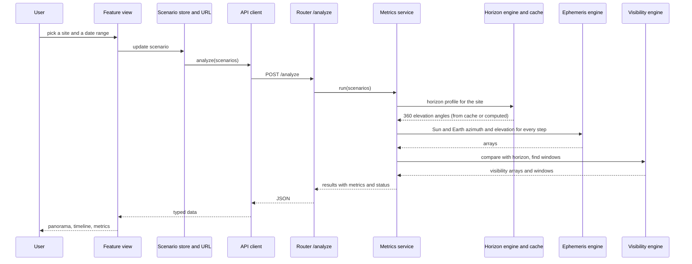
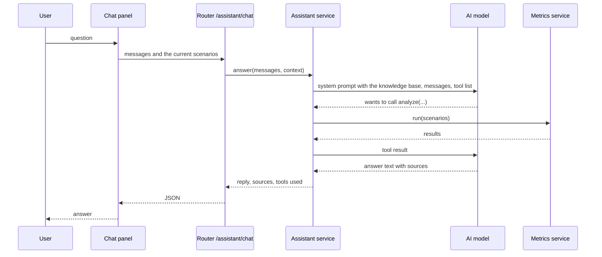

# Request lifecycle

Status: Design. Last updated: 2026-11-14.

Three flows cover almost everything the app does.

## 1. Analysing a scenario

This is the core path. The panorama, the timeline, the metrics and the comparison all come from it.

Notes:

- Moving the time slider does not call the API. The response already holds the whole range, so the views read the sample for the current time from memory.
- Changing the site, the range or the step does call the API. Results are cached in the browser by scenario, so going back to an earlier scenario is instant.
- The horizon profile is cached on the API's disk by site, rounded to 0.001 degrees. The first request for a new custom site pays the cost; later ones do not.

## 2. Loading a 3D scene

| Scene | Calls | When |
| --- | --- | --- |
| Solar System | `GET /scene?t=` | On open, and when the date changes by a day or more |
| Moon globe | `GET /sites`, `GET /scene?t=` (for the direction of sunlight) | On open |
| Site view | `GET /terrain` for the height tile, plus the analysis already loaded | When the site changes |

The site view lights the terrain from the Sun's azimuth and elevation in the analysis. As the slider moves, only the light direction changes. See [frontend/3d-scenes.md](../frontend/3d-scenes.md).

## 3. Asking the assistant

The assistant service limits the number of tool calls in one answer. See [backend/assistant.md](../backend/assistant.md).

## When something fails

| Failure | What the user sees |
| --- | --- |
| Invalid input | The field is marked before any request is sent |
| API returns an error | The panel shows the message from the error and a retry button; other panels keep their last good data |
| API cannot be reached | For curated sites, the app loads the precomputed result from `public/fallback/` and says so; for custom sites it explains that live calculation is unavailable |
| 3D cannot start (no WebGL, weak device) | The scene is replaced by a still image; the panorama and metrics still work |
| Assistant fails | The chat panel shows an error; nothing else is affected |
