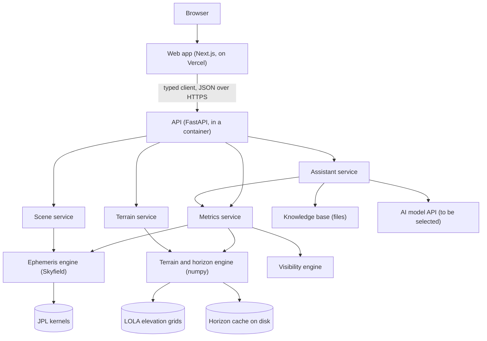

# System overview

Status: Design. Last updated: 2026-11-14.

## What the system does

Input: one to four scenarios. A scenario is a site on the Moon (a curated site or any latitude and longitude) and a time range.

Output for each scenario:

- the terrain horizon around the site, as an elevation angle for every degree of azimuth;
- the azimuth and elevation of the Sun and of the Earth at every time step;
- whether each is above the terrain horizon at every step;
- the windows when the Sun is up, when the Earth is up, and when both are;
- summary metrics and a go, caution or no-go status for power and for communication.

The web app turns that output into a horizon panorama, a timeline, metric tiles, a comparison table and 3D scenes. A chat assistant can explain the output and can run the same calculation through the API.

## The parts

| Part | Responsibility | Details |
| --- | --- | --- |
| Web app | All screens, 3D scenes, charts, chat panel. Holds no science. | [frontend/](../frontend/routes-and-state.md) |
| Contract | One OpenAPI file generated from the API; TypeScript types generated from it. | [repository-structure.md](repository-structure.md) |
| API routers | Check input, call one service, shape errors. | [backend/service-layer.md](../backend/service-layer.md) |
| Metrics service | Runs a scenario: horizon, positions, visibility, windows, metrics, status. | [science/visibility-and-metrics.md](../science/visibility-and-metrics.md) |
| Scene service | Positions of the Sun, planets, Earth and Moon for the 3D scenes. | [backend/api-reference.md](../backend/api-reference.md) |
| Terrain service | Height tiles for the 3D site view. | [science/terrain-and-horizon.md](../science/terrain-and-horizon.md) |
| Assistant service | Chat grounded in the knowledge base and in tool calls to the metrics service. | [backend/assistant.md](../backend/assistant.md) |
| Ephemeris engine | Where the Sun, the Earth and the planets are, seen from a point on the Moon. | [science/conventions-and-ephemeris.md](../science/conventions-and-ephemeris.md) |
| Terrain and horizon engine | Reads elevation grids, builds the horizon profile. | [science/terrain-and-horizon.md](../science/terrain-and-horizon.md) |
| Visibility engine | Compares positions with the horizon, finds windows. | [science/visibility-and-metrics.md](../science/visibility-and-metrics.md) |

## Principles

1. **The API owns the science, the web app owns the picture.** The web app never decides whether something is visible. This keeps one answer, one place to test.
2. **One contract.** Both sides are generated from or checked against the same OpenAPI file.
3. **Live calculation, cached horizons.** Positions are cheap to compute for any place and time. The horizon profile is the slow part, so it is computed once per site and stored.
4. **Works without the extras.** The core path (pick a site and date, see the panorama and the metrics) depends only on the metrics endpoint. The 3D scenes, the landing page and the assistant sit on top and can fail without breaking it.
5. **No accounts, no stored user data.** A scenario lives in the URL, so a link reproduces a result.

## Runtime shape

- **Web app:** static and server-rendered pages on Vercel. 3D scenes run in the browser.
- **API:** one container. It holds the kernels and the elevation grids on its disk and keeps the grid memory-mapped, so memory use stays low.
- **Outside services:** only the AI model API, and only for the assistant.

There is no queue, no scheduler and no database. See [developer/deployment.md](../developer/deployment.md).

## Expected sizes

| Thing | Size |
| --- | --- |
| One scenario, 30 days at 1 hour steps | 720 samples |
| Horizon profile | 360 values |
| Height tile for the site view | 257 by 257 heights |
| South pole elevation grid (80 m per pixel) | about 111 MB on disk |
| Limit per request | 4 scenarios, 10,000 samples each |
