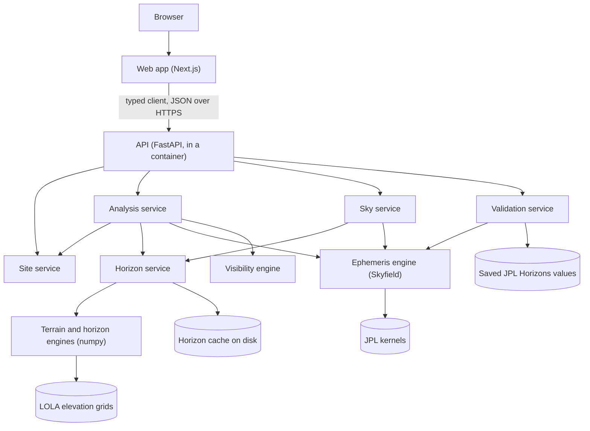

# System overview

Status: Partly built. Last updated: 2026-11-14.

## What the system does

Input: one to four scenarios. A scenario is a site on the Moon (a curated site or any latitude and longitude) and a time range.

Output for each scenario:

- the terrain horizon around the site, as an elevation angle for every degree of azimuth;
- the azimuth and elevation of the Sun and of the Earth at every time step;
- whether each is above the terrain horizon at every step;
- the windows when the Sun is up, when the Earth is up, and when both are;
- summary metrics and a go, caution or no-go status for power and for communication.

The web app turns that output into a verdict, a 30-day calendar, the best windows and 3D views. For a single moment at one point it uses `GET /sky`. A horizon panorama, a comparison table and a chat assistant are planned.

## The parts

| Part | Responsibility | State | Details |
| --- | --- | --- | --- |
| Web app | All screens and 3D scenes. Holds no science. | Being written | [frontend/routes-and-state.md](../frontend/routes-and-state.md) |
| Contract | One OpenAPI file generated from the API; TypeScript types generated from it. | Built | [repository-structure.md](repository-structure.md) |
| API routers | Check input, call one service, shape errors. | Built | [backend/service-layer.md](../backend/service-layer.md) |
| Site service | The curated sites; turns a site reference into a site. | Built | [data/sites.md](../data/sites.md) |
| Analysis service | Runs a scenario: horizon, positions, visibility, windows, metrics, status. | Built | [science/visibility-and-metrics.md](../science/visibility-and-metrics.md) |
| Sky service | The Sun and the Earth at one point and moment; the sub-solar and sub-Earth points. | Built | [backend/api-reference.md](../backend/api-reference.md) |
| Horizon service | Horizon profiles, cached in memory and on disk. | Built | [science/terrain-and-horizon.md](../science/terrain-and-horizon.md) |
| Validation service | Our angles next to saved JPL Horizons values. | Built | [science/validation.md](../science/validation.md) |
| Ephemeris engine | Where the Sun and the Earth are, seen from a point on the Moon. | Built | [science/conventions-and-ephemeris.md](../science/conventions-and-ephemeris.md) |
| Terrain and horizon engines | Read the elevation grids, build the horizon profile. | Built | [science/terrain-and-horizon.md](../science/terrain-and-horizon.md) |
| Visibility engine | Compares positions with the horizon, finds windows. | Built | [science/visibility-and-metrics.md](../science/visibility-and-metrics.md) |
| Terrain tiles | Height tiles for a 3D site view. | Planned | [science/terrain-and-horizon.md](../science/terrain-and-horizon.md) |
| Assistant service | Chat grounded in a knowledge base and in tool calls to the analysis service. | Planned | [backend/assistant.md](../backend/assistant.md) |

## Principles

1. **The API owns the science, the web app owns the picture.** The web app never decides whether something is visible. This keeps one answer, one place to test.
2. **One contract.** Both sides are generated from or checked against the same OpenAPI file.
3. **Live calculation, cached horizons.** Positions are cheap to compute for any place and time. The horizon profile is the slow part, so it is computed once per site and stored.
4. **Works without the extras.** The core path (pick a site and a moment, see the verdict and the windows) depends only on `/sites` and `/analyze`. The 3D scenes sit on top and can fail without breaking it.
5. **No accounts, no stored user data.** A scenario lives in the URL, so a link reproduces a result.

## Runtime shape

- **Web app:** planned on Vercel. 3D scenes run in the browser.
- **API:** one container. It holds the kernels and the elevation grids on its disk and keeps the grids memory-mapped, so memory use stays low.
- **Outside services:** none at run time. A planned assistant would call an AI model API.

There is no queue, no scheduler and no database. See [developer/deployment.md](../developer/deployment.md).

## Expected sizes

| Thing | Size |
| --- | --- |
| One scenario, 30 days at 1 hour steps | 720 samples |
| Horizon profile | 360 values |
| South pole elevation grids (80 m and 120 m per pixel) | about 116 MB each on disk |
| Horizon profile samples | 575 per direction, 207,000 per site |
| Limit per request | 4 scenarios, 10,000 samples each |
